  

  
  

 

  <b>Developer at CulturaSoft by day:</b> Angular on the front, Go on the back, PostgreSQL underneath. 
  Systems Engineering student at UPB and member of its cybersecurity research seedbed.

  I'm steering toward <b>game development</b> and <b>security</b>. I mod Source 2 games, model in Blender 
  and keep a few Linux VMs around to break on purpose.

 

<h3 align="center">Focus</h3>

  

 

<h3 align="center">Stack</h3>

  

 

<h3 align="center">Journey</h3>

  

 

<h3 align="center">Looking for</h3>

  

 

  Have a role or a project in mind? <a href="mailto:cristhian.gomez@upb.edu.co">Send me an email</a>.

