  

  
  
  

 

  <b>Developer at CulturaSoft by day:</b> Angular on the front, Go on the back, PostgreSQL underneath. 
  Systems Engineering student at UPB and member of its cybersecurity research seedbed.

  I'm steering toward <b>game development</b> and <b>security</b>. I mod Source 2 games, model in Blender 
  and keep a few Linux VMs around to break on purpose.

 

<h3 align="center">Focus</h3>

  

 

<h3 align="center">Stack</h3>

  

 

<h3 align="center">Journey</h3>

  

 

<h3 align="center">Looking for</h3>

<table align="center">
<tr>
<td align="center" width="33%"><b>Roles</b> Frontend · Fullstack Junior Game Developer Security Analyst (junior)</td>
<td align="center" width="33%"><b>Best at</b> Angular · TypeScript Go · PostgreSQL Java · REST APIs</td>
<td align="center" width="33%"><b>Modality</b> Remote · Hybrid On-site in Bucaramanga Spanish (native) · English C1</td>
</tr>
</table>

 

  Have a role or a project in mind? <a href="mailto:[[EMAIL]]">Send me an email</a>.

